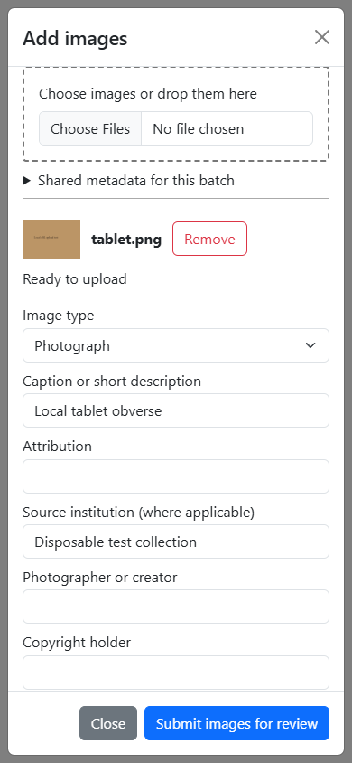
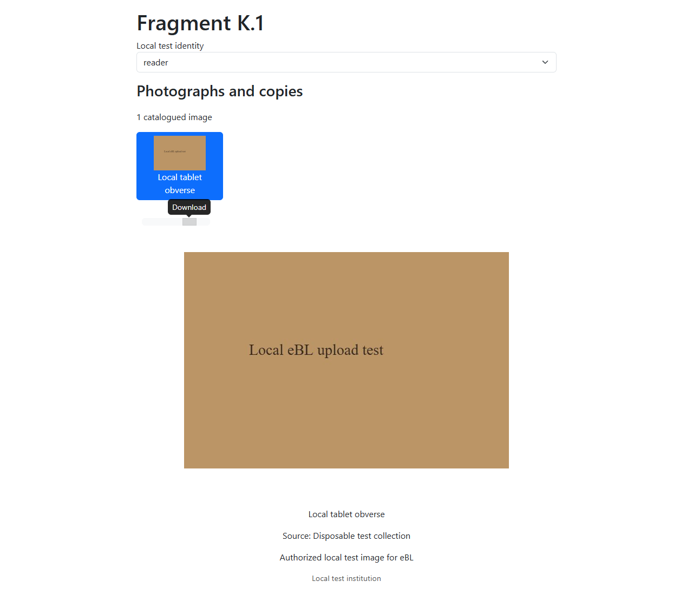

# Fragment media uploads and management

This extends the existing gallery in frontend #839 and requires backend #786
plus the companion upload/management PR. Backend migration #787 is optional and
is not bundled into either upload PR.

## Researcher workflow

With gallery and upload flags enabled, authorized contributors can open Images
even when a fragment has no photographs. Add images opens a keyboard-accessible,
scrollable dialog with file selection, drag/drop, previews, shared batch metadata,
and individual descriptions and rights. JPEG, PNG and WebP originals up to 25 MiB
are supported; SVG and animation ingestion are deferred. If the backend limit is
configured differently, align the client limit and displayed guidance before rollout.

Uploads run at most two at a time. Percentages come from XHR upload events;
processing has no invented percentage. Failed or cancelled transfers can be
retried with their original request identity. Editing their payload creates a new
identity. Closing/reopening preserves completed submissions during the current
fragment session; fragment/account changes abort requests and discard local drafts.
Cancellation can race a committed server response, so retrying the same request
identity is the safe way to resolve an uncertain submission.

New images always await review. Contributors see their own status and rejection
notes and may edit their own pending descriptions/context. Managers can edit
metadata, publish, reject, set a published primary, and confirm removal. Mutations
refresh only after server confirmation. Originals cannot be replaced. Legacy
caption/attribution and rights annotations preserve import provenance. Legacy
rights annotations do not fabricate upload identities or permission attestations.

The existing viewer, zoom, original download, captions, attribution, museum
copyright, pagination, folios, CDLI, and original-only/legacy fallbacks remain.

## API and authorization

The application interface is `MediaManagementRepository`, implemented by
`ApiMediaManagementRepository`. Components make no direct network calls.
`ApiClient` supplies authenticated XHR binary uploads with abort/error reporting
and cancellable JSON mutations. FragmentService invalidates only affected fragment,
thumbnail, and query-result cache entries. Providers and requests are scoped to
the authentication session.

All identifiers use URL-encoded `?fragment=...`, preserving museum numbers with
slashes. Upload is raw `POST /media?fragment=...`, with bearer authentication,
`Content-Type`, a canonical UUID `Idempotency-Key`, and URI-encoded JSON
`X-Media-Metadata`. Metadata contains `originalFilename`, `type`, `caption`,
`rightsStatement`, `permissionAttested: true`, applicable `sourceInstitution`, and
optional creator, copyright, attribution, description, references `[{id}]`, and
project enum names. Successful writes return canonical `{media: [savedItem]}`.

Gallery responses may include `legacyFallbackAllowed: false` after removal of a
migrated canonical legacy photograph. The repository exposes this visibility
decision without changing the existing array-based read interface. It suppresses
legacy fallback after refresh and physical cleanup; malformed visibility decisions
fail closed. The backend also blocks old photo and thumbnail routes while
retaining borrowed original bytes.

Other operations are `PATCH /media/{id}`, `POST /media/{id}/primary`, `/publish`,
`/reject`, and `DELETE /media/{id}`, all with the fragment query parameter.
Management listing uses `GET /media?fragment=...&view=management`; a disabled
backend write API falls back to ordinary published retrieval. Permission failures
remain errors. Backend authorization is authoritative for every mutation and binary.

Auth0 API role assignments must be configured externally:

- `upload:fragment_media`: approved contributors.
- `manage:fragment_media`: media reviewers/managers, also permits upload.
- Existing restricted fragment read scopes remain mandatory independently.

Permission attestation and rights are explicit; photographer or EXIF attribution
does not imply permission. Readers receive published records only. Management
identity/review fields are supplied only in authorized management responses.

## Rollout and rollback

1. Merge the retrieval/gallery foundations (#786 and #839), then both companion
   upload PRs. #787 remains a separate optional migration.
2. Keep `MEDIA_UPLOAD_ENABLED=false` and
   `REACT_APP_MEDIA_UPLOAD_ENABLED=false` initially. Both default to disabled;
   `REACT_APP_MEDIA_GALLERY_ENABLED` independently controls existing reads.
3. Follow the backend operations document for explicit index preparation,
   transaction-capable MongoDB, temporary disk/resource limits, proxy headers,
   and Auth0 assignments. No startup migration or automatic index preparation occurs.
4. Validate in a nonproduction environment; enable backend reads and writes, then
   build the frontend with both gallery/upload flags enabled. Docker build args
   and CI repository variables support these flags without enabling production.

Rollback by rebuilding with the frontend write flag disabled and disabling the
backend write flag. Keep the read gallery enabled and retain submission metadata
and binaries. Do not deploy an older reader that ignores publication state while
unpublished records remain. Physical cleanup requires all readers/writers drained
and the backend's explicit offline recovery command; HTTP removal retains bytes.

## Reproducible local browser verification

The checked-in test harness uses production UI components, API adapters, and
binary transport against `ebl.tests.media.e2e_server` in the backend checkout.
It uses only fixed **test** bearer identities and a dedicated disposable MongoDB;
it does not exercise production Auth0 login or use production data.

Run the backend test server in an isolated container with transaction-capable
MongoDB named `ebl-media-upload-test-mongo`, `MEDIA_API_ENABLED=true`,
`MEDIA_UPLOAD_ENABLED=true`, and `MEDIA_E2E_MONGODB_URI` pointing to that host.
Publish its port 8000 only on host loopback port 18808. The server rejects other
Mongo hosts and creates a random test database. Install isolated browser tools
and run from the frontend repository:

```sh
npm install --prefix .media-work/browser-tools --no-save esbuild playwright
node scripts/media-upload-e2e/serve.mjs
# In another terminal, with Chrome installed:
node scripts/media-upload-e2e/browser.mjs
```

Restart the disposable backend server for a fresh database before rerunning.
The harness serves loopback port 18809 and proxies media requests to loopback 18808. It verifies actual file selection, authenticated raw upload, server image
validation, GridFS/Mongo persistence, pending visibility denial, manager publish
and primary selection, reader thumbnail/display rendering, and byte-identical
original download. Reader upload returns 403 and pending binary retrieval 404.
Evidence and JSON results are written to ignored `.media-work/evidence`.

The recorded successful run preserved 12,798 original bytes with SHA-256
`6e902c7f7973a66fe73ccbfe4556573c927e5e40dad4869c63d62a1b67d17be4`.
Desktop and 390px mobile screenshots were visually inspected. The screenshots
below use a disposable test collection and synthetic tablet image.





## Manual verification checklist

- Enable both flags and assign only the intended contributor/manager scopes.
- Open an empty Images tab; select or drop multiple files and apply shared rights.
- Check required fields, invalid files, individual errors, cancellation, and retry.
- Confirm pending files cannot be retrieved as a reader using their real file URLs.
- Publish, reject, edit, set primary, and remove; refresh and verify persisted results.
- Switch fragment/account during a request; verify no private state appears elsewhere.
- Check keyboard focus, Escape dismissal, mobile scrolling/actions, and legacy photos.
- Remove a migrated legacy photo and reload; confirm fallback/old thumbnail URLs
  cannot reveal it again while its borrowed bytes remain recoverable.
- Disable writes independently; verify published gallery/folios/CDLI/downloads remain.
